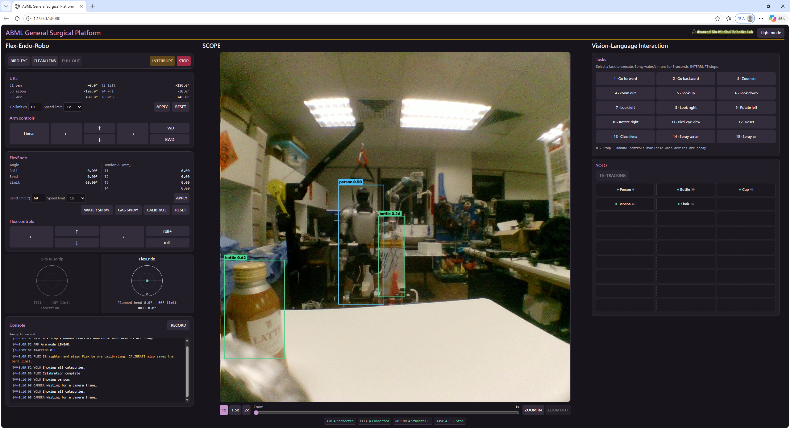

# CRF

CRF is an integrated surgical agentic system for gastrectomy. This repository provides its flexible endoscopic robot subsystem: a UR5 arm, a tendon-driven flexible endoscope, camera perception, and voice commands, operated from one browser dashboard.

[Setup](#setup) · [Run](#run) · [Configure](#configure) · [Operate](#operate) · [Keyboard shortcuts](#keyboard-shortcuts) · [Tasks](#tasks) · [Record and replay](#record-and-replay)



## Setup

Use a **Windows PC** with Conda. The full system also needs a connected UR5, GTS controller, and camera. Run the commands below in PowerShell from the repository root.

### 1. Create the environment

```powershell
conda env create -f environment.yaml
conda activate crf
```

For an existing `crf` environment, install the latest voice dependencies with:

```powershell
python -m pip install -r src/llm/requirements.txt
```

### 2. Prepare the speech models

```powershell
python -m streamingcommand.cli --config src/llm/settings.json doctor
python -m streamingcommand.cli --config src/llm/settings.json download
```

Download the models once before starting the app; allow approximately 11.5 GB of storage. The app loads cached models and opens the server PC's microphone at startup, including in camera-only and simulated Flex modes. Voice task triggering starts off. See [voice setup](src/llm/README.md) for GPU dependencies, model settings, and microphone configuration.

### 3. Build the Flex driver

Physical and simulated Flex control both require the native driver. Install Visual Studio 2022 with **Desktop development with C++**, **MSVC v143**, and a **Windows SDK**. Open:

```text
src/flex_endo_robo/flex_endo/FlexEndoscopeDriver.sln
```

Build **Debug | x86**. The launcher expects:

```text
src/flex_endo_robo/flex_endo/build/Win32/Debug/FlexEndoscopeDriver.exe
```

The build copies `gts.dll` and `GTS800.cfg` beside the executable. If you build **Release | x86**, add `-Configuration Release` when launching. Camera-only mode does not need this driver.

## Run

Activate `crf` before each session. Choose one mode and stop the current session before launching another.

### Full system

Connect the UR5, GTS controller, and camera, then launch with your robot's address:

```powershell
conda activate crf
.\src\flex_endo_robo\flex_endo\Start-FlexControl.ps1 -RobotIp 192.168.1.10 -Feedback Encoder
```

Open the [control dashboard](http://127.0.0.1:8080). The launcher starts the Flex driver, UR5 connection, camera, and dashboard together.

**Choose feedback explicitly:** `Encoder` uses encoder feedback; `Planned` moves physical motors using planned positions without encoder verification; `Simulated` simulates Flex motors only. The launcher defaults to `Planned`. A full-system launch with `Simulated` still connects to the real UR5.

### Simulated Flex

```powershell
.\src\flex_endo_robo\flex_endo\Start-FlexControl.ps1 -FlexOnly -Feedback Simulated
```

This runs Flex control without a UR5 connection or physical Flex motion. The camera still uses a real device. Use **CALIBRATE** to establish Flex zero, then try jogging and Flex-only tasks. Tracking requires the full system.

### Camera only

```powershell
python src/app.py --camera-only
```

Use this for live preview, detections, recording, and digital zoom without connecting to the UR5 or Flex driver.

### End a session

Use **INTERRUPT** or `I` to stop motion or a task while keeping the app open. Press `Ctrl+C` in the launcher terminal to end the session.

## Configure

Common PowerShell launcher settings:

| Option | Default | Use |
| --- | --- | --- |
| `-RobotIp` | `192.168.1.10` | UR5 network address. |
| `-Feedback` | `Planned` | Choose `Encoder`, `Planned`, or `Simulated`. |
| `-FlexOnly` | Off | Run without the UR5 connection. |
| `-Configuration` | `Debug` | Select the `Debug` or `Release` driver build. |
| `-Port` | `8080` | Dashboard port. |
| `-CameraRollOffsetDeg` | `0` | Camera roll relative to the modeled camera, from −180° to 180°. |
| `-GasPort` | `COM4` | Gas controller serial port. |
| `-WaterVelocity` | `30` | Signed water pump velocity; nonzero, from −30 to 30. |

For example, to use another dashboard port and gas controller port:

```powershell
.\src\flex_endo_robo\flex_endo\Start-FlexControl.ps1 -RobotIp 192.168.1.10 -Feedback Encoder -Port 8081 -GasPort COM5
```

For another camera or YOLO model in camera-only mode:

```powershell
python src/app.py --camera-only --camera-index 1 --model path/to/weights.pt --port-web 8081
```

The dashboard starts in **Test mode**, using the bundled detector for **person, bottle, cup, banana, and chair**. Click **Test mode** beside **Light mode** to turn testing off and enter **Full mode**: Gastro28 surgical segmentation and temporal stage recognition. The current mode appears beside SCOPE. This perception setting is independent of the camera-only/Flex-only/full-system launch options.

Full mode requires these local files under `models/scope/` (already installed on the integration PC):

| File | Source in the supplied Gastro28 handoff package |
| --- | --- |
| `gastro28_yolo26m_seg.pt` | `assets/vision_checkpoints/Gastro28/YOLO26/yolo26m-seg/fold0/train/weights/best.pt` |
| `YOLO26m_CausalMSTCN_fold0.pt` | `assets/temporal_checkpoints/Gastro28/YOLO26m_CausalMSTCN_fold0.pt` |
| `YOLO26m_TeCNO_fold0.pt` (optional alternative) | `assets/temporal_checkpoints/Gastro28/YOLO26m_TeCNO_fold0.pt` |

Copy and rename the paired weights as shown when setting up another PC. Model files are ignored by Git. The segmentation weights must match the temporal checkpoint; unrelated 28-class models cannot be substituted. Use `--surgical-model PATH` and `--temporal-model PATH` for other local locations. Missing or incompatible models produce dashboard errors while camera preview remains available; switch back to Test mode to resume the bundled detector. There are no model downloads during operation.

Custom **test** detectors need matching class labels in `src/scope/yolo.py`. During operation, set arm/Flex speed and motion limits in the dashboard and click **APPLY**.

See [advanced configuration](docs/DEVELOPMENT.md#advanced-configuration) for geometry, microphone, model settings, output directories, and direct Python launch options.

## Operate

1. Open the dashboard and check the device status and console. Wait for the required devices to become ready.
2. Set motion limits and speeds. Calibrate Flex to save its intended zero position.
3. Choose **Linear** for arm translation or **RCM** for motion about a captured remote center of motion. Select RCM before coordinated look tasks, tracking, or an RCM tip reset.
4. Hold the dashboard direction buttons or motion keys to jog; release to stop. Select a task for continuous movement or a procedure.
5. Use **INTERRUPT** whenever you need to stop a task. If TASK shows Error, inspect the console and use INTERRUPT before retrying.

Shortcuts work while the dashboard has focus. Editing a form suspends them. Leaving the page or switching applications releases held motion, zoom, and keyboard Freedrive.

### Hand guiding

With devices stationary, controls released, and Task 0 selected, click **FREEDRIVE** to guide the UR5 by hand. Click it again to hold the current pose, or use INTERRUPT. Alternatively, hold `Alt+Shift+F`; releasing `F`, `Alt`, or `Shift` requests exit.

Check the installed tool's payload and center of gravity on the pendant before hand guiding. Keep the dashboard focused; losing focus or its heartbeat ends Freedrive. After repositioning, select RCM again to capture a new pivot.

### Bird-eye view and withdrawal

**BIRD-EYE** moves to a level view looking 30° downward. Its button is yellow while moving and green at the target pose.

**PULL OUT** uses two presses: the first prepares the zero pose; once the button turns sky blue, verify scope straightness and the withdrawal path, then press again within 30 seconds to withdraw. The button is yellow while moving and green when complete. Active RCM and ready devices are required.

### Tracking

Select a detection category, calibrate Flex, and enable UR5 RCM. Press **TRACKING** or `Alt+T` to start Task 16. The button is green while tracking, sky blue while waiting for a target, and yellow when motion is limited. Press the same command again or INTERRUPT to stop.

The YOLO section switches between five test categories and 27 surgical categories; background is excluded. Use INTERRUPT before changing perception mode during tracking. A mode change clears the selected category and previous tracking observations, so select the new target before restarting tracking.

### Surgical stage recognition

On desktop, each side panel takes one quarter of the available column width, leaving half for the camera. The translucent stage card floats over the camera's upper-left corner. The camera stays square (1:1), scaling to the available width or height, whichever is smaller. At 1x zoom the full source image is retained; non-square sources are letterboxed. On small screens, scroll inside the stage card to see the full list.

Full mode segments the latest available frames as fast as inference allows. An independent stage worker samples the same raw camera stream at **1 Hz**, using its own segmentation pass and Causal MS-TCN temporal head. Confidence appears inside the model's top three stage boxes, with the current stage highlighted; a dash means no score was returned for that stage. Stage IDs and names are in the [development guide](docs/DEVELOPMENT.md#gastro28-perception).

Stages before the current recognized stage light up with full vertical timing segments; for example, recognizing stage 6 lights stages 1–5. The current stage's segment fills using **elapsed time / statistical duration**. The fixed durations for stages 1–7 are **40.8, 568.8, 101.4, 583.8, 490.2, 830.4, and 216.6 seconds**. The highlighted stage shows elapsed and statistical duration in seconds. Elapsed time resets when the recognized stage changes or temporal context resets; timing is hidden while recognition is stale. The fill caps at 100% while the elapsed timer continues. Earlier-stage highlights follow the current stage number and clear if recognition moves backward, becomes stale, or enters Test mode. Confidence scores remain the model's current predictions. These highlights and timing ratios do not verify surgical completion.

In Test mode the stage card stays visible but inactive; stage inference stops and predictions are cleared. Switching perception mode or a gap in stage sampling resets temporal context. Selecting another category leaves stage context intact.

### Separate live view

Click **Open live view ↗** in the dashboard header to duplicate the surgical stage and annotated camera into a new tab, or open [the live view](http://127.0.0.1:8080/live) directly. Move that tab to another window or monitor as needed. The left quarter shows surgical stages, the middle half shows the annotated camera, and the right quarter is blank. The camera keeps its square viewport with the full source image visible at 1× zoom.

The view follows the running app's perception mode, selected category, and digital zoom. Dashboard zoom buttons, slider, presets and keyboard zoom are mirrored, and zoom Tasks 3/4 continue updating the live view while the dashboard is in the background. Stages remain inactive in Test mode. This is a passive display with its own theme button; it does not send robot commands or take keyboard control. The app must remain running, and closing either tab leaves the other available. Saved-session replay remains at `/viewer`.

The **ARM**, **FLEX**, **MOTION**, **TASK** and **LLM** status bar sits below the live camera and uses the same labels and colors as the dashboard. Indicators update independently of the camera; unavailable status feeds clear their previous values until they reconnect.

### Voice commands

The app recognizes speech in the background. Press **LISTEN** or `Alt+L` to enable task triggering, then speak a command such as “move forward,” “look left,” “zoom in,” or “track the bottle.” Check the transcript and task result in the LLM panel.

Beside **LISTEN**, **Loading 12.3s** shows elapsed model startup time; once both ASR and LLM are ready, **Loaded in 12.3s** retains the total startup duration, including resource verification and warmup. Reloading the dashboard or toggling LISTEN preserves this time.

With LISTEN enabled, the standalone English word **stop** triggers Task 0 as soon as it appears in recognition. Turning LISTEN off leaves an already-running task active; use INTERRUPT or `I` to stop it. Voice tracking resolves names against the active perception mode's categories; a command without a named target uses the selected category. Surgical names require Full mode.

## Keyboard shortcuts

Hold motion, zoom, and Freedrive keys. Press other shortcuts once; key repeat does not repeat a command.

| Action | Keys |
| --- | --- |
| UR5 up / down / left / right | `Up` / `Down` / `Left` / `Right` |
| UR5 forward / backward | `]` / `[` |
| Flex look up / down / left / right | `W` / `S` / `A` / `D` |
| Flex roll clockwise (+) / counterclockwise (−) | `R` / `F` |
| BIRD-EYE | `Alt+B` |
| PULL OUT (prepare, then confirm) | `Alt+P` |
| INTERRUPT | `I` |
| Toggle TRACKING | `Alt+T` |
| Toggle RECORD | `Alt+R` |
| Toggle Linear / RCM | `Alt+M` |
| Hold FREEDRIVE | `Alt+Shift+F` |
| Zoom in / out | `=` / `-` |
| Toggle LISTEN | `Alt+L` |

Zoom ranges from 1× to 2×; `Shift+=` and numpad `+` / `-` also work. Manual zoom is locked while Tasks 3 or 4 control it. Flex roll keys apply to the physical or simulated driver; in arm-only modeled mode, use the on-screen arc controls.

## Tasks

The Tasks card offers Tasks 1–15. INTERRUPT selects Task 0; TRACKING selects Task 16. Voice commands use the same tasks and device requirements.

| ID | Task | What it does |
| --- | --- | --- |
| 0 | Stop | Cancel the current task and stop motion. |
| 1 | Go forward | Continuously advance the UR5 tip. |
| 2 | Go backward | Continuously retract the UR5 tip. |
| 3 | Zoom in | Increase digital zoom to 2×, then hold. |
| 4 | Zoom out | Decrease digital zoom to 1×, then hold. |
| 5 | Look up | Bend Flex upward first, then use UR5 assistance at the Flex limit. |
| 6 | Look down | Apply the same Flex-first movement downward. |
| 7 | Look left | Apply the same Flex-first movement leftward. |
| 8 | Look right | Apply the same Flex-first movement rightward. |
| 9 | Rotate left | Roll the camera counterclockwise; hold at the limit. |
| 10 | Rotate right | Roll the camera clockwise; hold at the limit. |
| 11 | Bird-eye view | Move to a level view looking 30° downward. |
| 12 | Reset | Reset Flex to saved zero; in RCM, also restore UR5 tip tilt while preserving the pivot and insertion depth. |
| 13 | Clean lens | Run the lens-cleaning sequence. |
| 14 | Spray water | Spray water for three seconds. |
| 15 | Spray air | Spray air for three seconds. |
| 16 | Tracking | Follow the selected detection category using Flex and UR5 assistance. |

Tasks lock manual robot controls. Continuous Tasks 1–10 and 16 stay selected until stopped, replaced, or failed, including when holding at a limit. Tasks 11–15 return to Stop after confirmed completion. Use INTERRUPT to regain manual control.

Look Tasks 5–8 and Reset require active RCM when the UR5 is connected. Tracking also requires calibrated Flex and fresh camera observations. Flex-only mode omits UR5 assistance and cannot run Tasks 1, 2, 11, or 16. Camera-only mode supports zoom Tasks 3 and 4; arm-only modeled mode cannot run Tasks 13–16. Pump tasks require the Flex driver and ready outputs.

## Record and replay

Press **RECORD** or `Alt+R` to start or stop recording. Sessions are saved under `recordings/` in five-minute slices; the slice index starts at `00000` and the timer resets for each slice. Recordings include annotated and clean camera images, robot/pump state, commands, task events, detections/segmentation polygons, stage predictions, configuration, console messages, speech results, and microphone audio. Audio includes silence and speech while LISTEN is off; RECORD controls storage independently of task triggering. Audio is the unfiltered mono 16 kHz PCM supplied to ASR after input resampling, saved as WAV. Clean camera images use JPEG compression. See the [recording coverage table](docs/DEVELOPMENT.md#recording-and-diagnostics) for rates and limits.

Click **Open recording viewer** beside the recording controls, or open [the dashboard viewer](http://127.0.0.1:8080/viewer). Select a session and use play/pause, seek, and playback speed to inspect the camera, motion charts, and event timeline.

Select **Clean camera image** to inspect frames without overlays. **Listen from cursor (15s)** opens a microphone clip at the selected time with its own audio controls. Older recordings remain readable but do not contain these new media streams. Each slice's `microphone.wav` can also be opened directly; timeline indexes preserve recording boundaries and audio gaps.

To replay without starting cameras or robot connections:

```powershell
conda activate crf
python src/recording_web.py
# Or show one session:
python src/recording_web.py recordings/SESSION_ID --port 8081
```

Open [the standalone viewer](http://127.0.0.1:8081/viewer). Use **REFRESH** to reload the session list.

For desktop playback or plot export:

```powershell
python src/recording_viewer.py recordings/SESSION_ID
python src/recording_viewer.py recordings/SESSION_ID --output activity.png
python src/recording_viewer.py recordings/SESSION_ID --summary
```

## Troubleshooting

| Symptom | What to check |
| --- | --- |
| Driver executable missing | Build the selected Debug/Release x86 configuration and check the path in [setup](#3-build-the-flex-driver). |
| Launcher asks for the environment | Run `conda activate crf` in the same terminal. |
| Driver already running | End the previous control session before relaunching. |
| Camera unavailable | Check the connection and camera index; try camera-only mode. |
| Speech models unavailable | Run the model `doctor` and `download` commands in [setup](#2-prepare-the-speech-models). |
| Task refused or controls locked | Read the console, check device readiness, calibration and RCM requirements, exit Freedrive, then INTERRUPT before retrying. |

The console shows device and task messages. Each app run also saves warnings, errors, and tracebacks to `logs/`, independently of recording.

For code layout, advanced settings, tests, and implementation notes, see [development documentation](docs/DEVELOPMENT.md). Repository guidance for coding agents is in [AGENTS.md](AGENTS.md).
