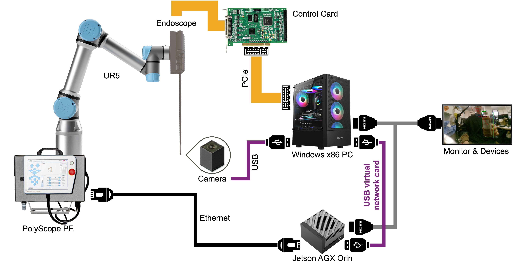

# CRF

## System Architecture



### IP Table

| Device | Interface | IP | Role |
|---|---|---|---|
| Windows PC | USB virtual network card | `192.168.55.100` | TCP Client -> Jetson |
| Jetson AGX Orin | `l4tbr0` (usb0) | `192.168.55.1` | TCP Server :9000 |
| Jetson AGX Orin | `end0` (LAN) | `192.168.1.100` | RTDE Client -> UR5 |
| UR5 (PolyScope) | LAN | `192.168.1.10` | RTDE Server :30004 |

## Communication Test

Run the commands from the repository root on each machine.

### 1. Jetson

```sh
conda activate crf
python src/jetson/rtde_server.py
```

The Jetson environment needs `ur-rtde`. The relay listens on the USB interface at
`192.168.55.1:9000` and connects to the UR5 at `192.168.1.10`. Use `--host`,
`--port`, or `--robot-ip` to match a different network configuration.

### 2. Windows

```powershell
conda activate zyx
python src/win/app.py
```

The Windows environment needs NumPy, PyKDL and a URDF-to-KDL parser. If your
environment has PyKDL and no parser, initialize the submodule and install it
with `python -m pip install ./dependencies/kdl_parser`. The app loads the
bundled URDF by default.

Open [http://127.0.0.1:8080](http://127.0.0.1:8080). Confirm that the joint
readings appear and Diagnostics shows Jetson connected and kinematics ready.

Manual arm controls default to a 10× speed multiplier. Use
`--jog-speed-scale` to select 3, 5, 10, or 15.

The **Dashboard Stop** button sends a program stop to PolyScope. After a
Dashboard stop or relay motion fault, check the robot before restarting the
Jetson relay. The physical emergency stop remains on the robot.
