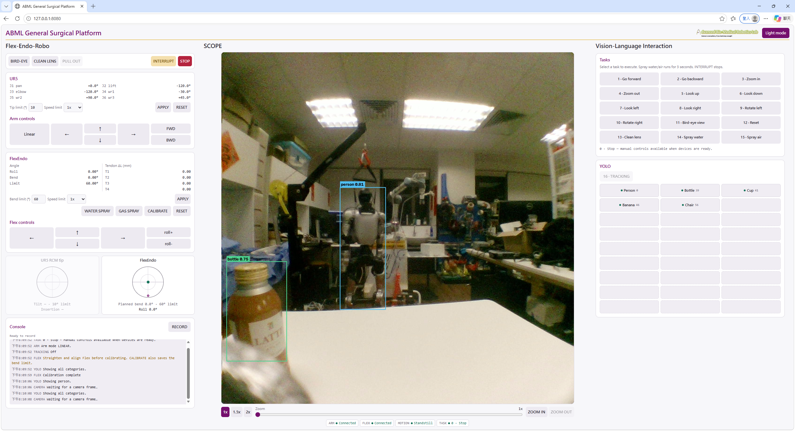
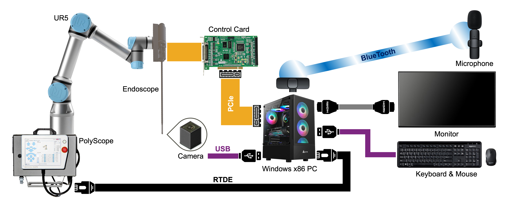
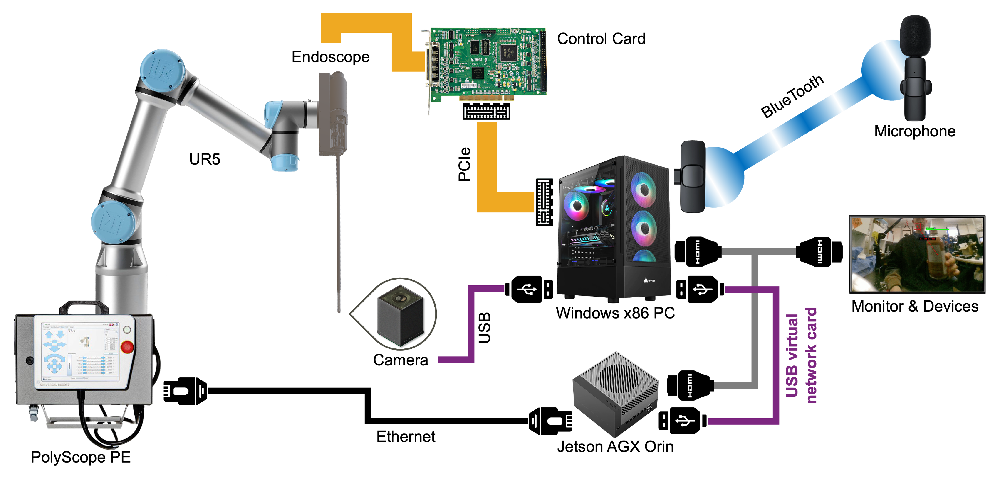

# CRF

CRF is an integrated surgical agentic system for gastrectomy. This repository currently implements the flexible endoscopic robot subsystem, combining UR5 arm control, a tendon-driven flexible endoscope, and camera-based perception in a browser dashboard.

[Demo](#demo) · [System overview](#system-overview) · [Configuration](#configuration)

## Demo

Use **Windows** with the UR5, GTS controller, and camera connected. For the first run, [build the native driver](#build-the-native-driver). Then run the following commands in PowerShell from the repository root:

```powershell
conda env create -f environment.yaml
conda activate crf
.\src\flex_endo_robo\flex_endo\Start-FlexControl.ps1
```

The launcher starts the Flex driver, UR5 RTDE relay, camera, and web dashboard together. Open the [control dashboard](http://127.0.0.1:8080) to access robot controls, live perception, and recording. See [keyboard shortcuts](keyboard_shortcuts.md) for motion and command mappings. Press `Ctrl+C` in the terminal to end the session.

The default UR5 address is `192.168.1.10`, and Flex uses `Planned` feedback with physical motors. See [configuration](#configuration) to change the robot address, feedback mode, or other settings.


<details>
<summary>Light mode</summary>



</details>

## System overview



The system integrates three components:

- **Robot control:** a UR5 arm controlled through RTDE and a native C++ Flex driver connected to the vendor GTS controller. Python coordinates remote center of motion (RCM) control, endoscope bending and roll, horizon leveling, and motion procedures.
- **Visual perception:** separate camera capture and YOLO inference workers provide live preview, object detections, and target observations for tracking. Inference processes the latest frame to avoid accumulating a backlog.
- **Interaction and recording:** the web dashboard provides manual controls, task execution, device status, and session recording. Timestamped state, commands, detections, and camera frames are stored in five-minute JSONL/MJPEG segments for replay and analysis.

The control coordinator requests a 125 Hz update rate and publishes dashboard snapshots at 20 Hz. Flex IPC, RTDE motion and telemetry, camera capture, inference, and HTTP handling run independently.

The supported deployment uses a Windows PC for the GTS driver and DirectShow camera capture. The UR5 connects directly through RTDE, so a separate ROS 2 bridge or Ubuntu machine is unnecessary for this setup.

<details>
<summary>Alternative deployment architecture</summary>



</details>

## Configuration

### Build the native driver

The simulated and physical Flex modes require the native driver. Install Visual Studio 2022 with **Desktop development with C++**, the **MSVC v143** toolset, and a **Windows SDK**. Open:

```text
src/flex_endo_robo/flex_endo/FlexEndoscopeDriver.sln
```

Select **Debug | x86** and build the solution. The launcher expects:

```text
src/flex_endo_robo/flex_endo/build/Win32/Debug/FlexEndoscopeDriver.exe
```

The build links the bundled x86 GTS library and copies `gts.dll` and `GTS800.cfg` beside the executable. If you build **Release | x86**, pass `-Configuration Release` to the launcher.

### Connect the full system

Connect the UR5, GTS controller, and camera to the Windows PC. Activate the `crf` environment, then launch with your UR5 IP address:

```powershell
.\src\flex_endo_robo\flex_endo\Start-FlexControl.ps1 -RobotIp 192.168.1.10 -Feedback Encoder
```

This starts the Flex driver, RTDE relay, camera, and dashboard. The launcher defaults to full-system mode. Choose the feedback mode explicitly: **Planned also controls physical motors**, using planned positions without encoder verification; **Encoder** uses encoder feedback; **Simulated** simulates only the Flex hardware. Use `-FlexOnly -Feedback Simulated` together for the Flex demo without a UR5 connection.

Common launcher settings:

| Option | Default | Purpose |
| --- | --- | --- |
| `-RobotIp` | `192.168.1.10` | UR5 network address in full-system mode. |
| `-Feedback` | `Planned` | `Planned`, `Encoder`, or `Simulated` Flex feedback. |
| `-FlexOnly` | Off | Run Flex controls without opening RTDE. |
| `-Configuration` | `Debug` | Select the `Debug` or `Release` driver build. |
| `-Port` | `8080` | Dashboard HTTP port. |
| `-CameraRollOffsetDeg` | `0` | Measured camera roll relative to the modeled Flex camera, from -180 to 180 degrees. |
| `-GasPort` | `COM4` | Serial port for the gas controller. |
| `-WaterVelocity` | `30` | Signed water pump velocity; nonzero, from -30 to 30. |

For example, to change the dashboard and gas controller ports:

```powershell
.\src\flex_endo_robo\flex_endo\Start-FlexControl.ps1 -RobotIp 192.168.1.10 -Feedback Encoder -Port 8081 -GasPort COM5
```

### Simulated Flex control

To try Flex controls without motor hardware, first [build the native driver](#build-the-native-driver), then run in the activated `crf` environment:

```powershell
.\src\flex_endo_robo\flex_endo\Start-FlexControl.ps1 -FlexOnly -Feedback Simulated
```

The launcher starts the simulated Flex driver and dashboard together. `-FlexOnly` disables the UR5 connection; `-Feedback Simulated` simulates the Flex motors. The camera feed still uses a real camera. This mode supports Flex jogging and calibration; procedures requiring a connected UR5, such as tracking, require the full system.

Open the dashboard, use **CALIBRATE** to establish a Flex zero position, and try the Flex controls. See [keyboard shortcuts](keyboard_shortcuts.md) for motion and command mappings. Stop this session before starting another demo or hardware session.

### Camera, model, and geometry

For a camera-only demo, run `python src/app.py --camera-only` in the activated `crf` environment. This starts the camera preview and dashboard without connecting to the UR5 or Flex driver.

Additional settings are available through `src/app.py`. For example, to preview another camera with custom YOLO weights:

```powershell
python src/app.py --camera-only --camera-index 1 --model path/to/weights.pt --port-web 8081
```

| Python option | Default | Purpose |
| --- | --- | --- |
| `--camera-index` | `0` | DirectShow camera device index. |
| `--model` | `src/scope/yolov8n.pt` | YOLO weights file. |
| `--host-web` / `--port-web` | `127.0.0.1` / `8080` | Dashboard bind address and port. |
| `--robot-ip` / `--relay-port` | `192.168.1.10` / `9000` | UR5 address and local RTDE relay port. |
| `--urdf` | `src/flex_endo_robo/ur5_endo_flex.urdf` | Robot and endoscope geometry. |
| `--rcm-local` | `0 0 -0.30` | Local RCM coordinates in meters. |
| `--tip-local` | `0 0 0.20195` | Local tip coordinates in meters. |
| `--camera-roll-offset-deg` | `0` | Optical roll offset in degrees. |
| `--jog-speed-scale` | `10` | Manual arm speed factor; choices: `3`, `5`, `10`, `15`. |
| `--recordings-dir` | Repository `recordings/` | Session output directory. |

Run `python src/app.py --help` for all options. The mutually exclusive `--camera-only`, `--flex-only`, and `--arm-only` modes select passive preview, Flex control, or UR5 control with modeled Flex, respectively. Running without a mode flag selects the full system. Direct Python launches using Flex require a separately running native driver; the PowerShell launcher manages that driver but exposes only the options in the launcher table.

The bundled YOLO model uses the categories defined in `src/scope/yolo.py`: person, bottle, cup, banana, and chair. When using a custom model, update `CATEGORIES` and `COLORS` in that file to match its class IDs and labels. Camera capture defaults (resolution and frame rate) are defined in `src/scope/camera.py`.

During a session, use the dashboard to set arm/Flex speed and motion limits, calibrate Flex, select a detection category, and control recording. Launch settings and runtime configuration changes are retained with the recordings.

### Replay a recording

Use **RECORD** in the dashboard to save a session under `recordings/`. The viewer reads saved files without connecting to the robot or camera. Replace `SESSION_ID` below with your session directory name:

```powershell
# Inspect the first five minutes of a saved session.
python src/recording_viewer.py recordings/SESSION_ID

# Export a plot or print an activity/configuration summary.
python src/recording_viewer.py recordings/SESSION_ID --output activity.png
python src/recording_viewer.py recordings/SESSION_ID --summary

# Follow the latest recording while it is being written.
python src/recording_viewer.py recordings --live
```


### Code layout

| Path | Role |
| --- | --- |
| `src/app.py`, `src/static/` | Application entry point, HTTP API, and dashboard. |
| `src/flex_endo_robo/` | Control coordinator, RTDE relay, kinematics, and URDF. |
| `src/flex_endo_robo/flex_endo/` | Python Flex interface, native driver, and launcher. |
| `src/scope/` | Camera capture and YOLO perception. |
| `src/status.py`, `src/recording_viewer.py` | Session recording and replay. |
| `src/tasks.py`, `tasks.md` | Task execution and task reference. |
| `tests/` | Hardware-free Python checks and native driver tests with mocked GTS calls. |
| `environment.yaml` | Pinned Windows Conda environment. |

The environment installs `kdl-parser-jvytee`. The `dependencies/kdl_parser` submodule is an upstream source reference with its own [documentation](dependencies/kdl_parser/README.md) and [license](dependencies/kdl_parser/LICENSE).
