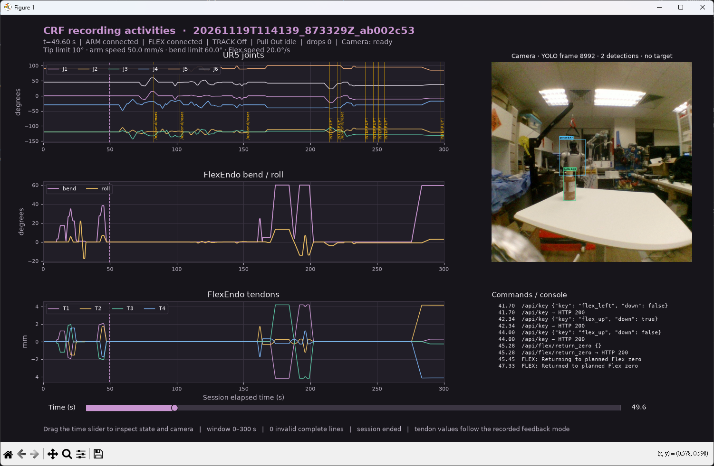

# CRF (Currently flexible endoscopic robot only)

CRF is an integrated surgical agentic system for gastrectomy. 


- [CRF (Currently flexible endoscopic robot only)](#crf-currently-flexible-endoscopic-robot-only)
  - [Prerequisites](#prerequisites)
  - [Quick start](#quick-start)
  - [Recording viewer](#recording-viewer)
  - [Architecture](#architecture)
    - [Thread ownership](#thread-ownership)
  - [File reference](#file-reference)
    - [Application](#application)
    - [Native Flex driver](#native-flex-driver)
    - [Repository and verification](#repository-and-verification)
    - [Bundled KDL parser dependency](#bundled-kdl-parser-dependency)


## Prerequisites

Due to control card driver supported system, the device system has to be ***Windows***. Hopefully we can use ***RTDE*** to control the UR5 robot arm, skipping the ROS2 bridge so there's no requirements for a second Ubuntu device. For an alternative, you may use a Jetson connecting to PC as a virtual network card. 


## Quick start

Run from the repository root:

```powershell
# Config python env
conda env create -f environment.yaml
conda activate crf

# Run the WebUI and control system in one-click
.\src\flex_endo_robo\flex_endo\Start-FlexControl.ps1
```

Open [the control panel](http://127.0.0.1:8080). 


## Recording viewer

Run the viewer in the `crf` environment (Matplotlib, NumPy, and Pillow are already
included). It reads files only and never connects to the arm, Flex, or camera.
The viewer and exported plots use the matching dark palette, with purple
playback cursors, gold command markers, and distinct colors for the traces.

```powershell
# Inspect the first five minutes of a saved session.
python src/recording_viewer.py recordings/<session-id>

# Export a static plot or a JSON activity/configuration summary.
python src/recording_viewer.py recordings/<session-id> --output activity.png
python src/recording_viewer.py recordings/<session-id> --summary
```




## Architecture

### Thread ownership

| Worker | Responsibility |
| --- | --- |
| Control coordinator | Steps motion procedures at a requested 125 Hz and publishes UI snapshots at 20 Hz. Uses an interruptible wait between ticks. |
| Flex IPC | Reads native feedback and writes the latest complete command/vision snapshots; retries short mutex contention independently of motion calculations. |
| RTDE motion | Sole owner of UR5 motion calls, including reset and stop. |
| RTDE receive and TCP receiver | Acquire and deliver arm telemetry independently of motion calculations. |
| Camera capture/preview | Reads the camera, encodes JPEGs, and publishes frames without waiting for inference. |
| YOLO inference | Processes the newest available raw frame; skips superseded frames instead of growing a queue. |
| HTTP request handlers | Serve controls, cached state, and MJPEG streams. State requests do not acquire the motion lock; stale control snapshots return HTTP 503. |


## File reference

### Application

| File | Functionality |
| --- | --- |
| `src/app.py` | Entry point, CLI options, HTTP API, dashboard asset serving, camera streaming, and coordinated stop/shutdown handling. |
| `src/status.py` | Recording schema/configuration collection, independent status sampling, timestamped events, bounded queue, and five-minute JSONL/MJPEG storage. |
| `src/tasks.py` | Shared task definitions/state and nonblocking execution, completion, limit, and failure handling on the coordinator. |
| `src/keyboard_listener.py` | Windows focus-gated bridge for browser-reserved Ctrl command shortcuts. |
| `src/recording_viewer.py` | Offline/live activity plots, time-slider inspection, camera/YOLO replay, PNG/PDF export, and JSON summary. |
| `src/static/index.html` | Dashboard structure: device controls, camera preview, category selector, status displays, and console. |
| `src/static/dashboard.css` | Dashboard colors, responsive layout, controls, and motion plot styling. |
| `src/static/dashboard.js` | Browser input handling, held-key heartbeats, API requests, state polling, category selection, and display updates. |
| `src/static/keyboard.js` | Keyboard motion/command mappings, repeat/editing guards, and native shortcut polling. |
| `src/flex_endo_robo/control_node.py` | 125 Hz coordinator, relay connection, input expiry, RCM capture, arm commands, modeled Flex, Bird-eye/Pull Out procedures, and state snapshots. |
| `src/flex_endo_robo/kinematics.py` | KDL chain construction, forward kinematics, camera/shaft geometry, RCM angle conversions, horizon leveling, and wrist-constrained inverse kinematics. |
| `src/flex_endo_robo/ur5_rtde_server.py` | RTDE relay, command validation, speed/RCM constraints, telemetry, watchdogs, interrupt handling, and Dashboard Stop. Also supports standalone relay execution. |
| `src/flex_endo_robo/ur5_endo_flex.urdf` | Robot description: UR5, endoscope mount, flexible section, camera frames, and visualization geometry. |
| `src/flex_endo_robo/flex_endo/flex_control.py` | Physical Flex state machine: calibration, jogging, horizon correction, camera tracking with arm assistance, positioning, return to zero, and withdrawal. |
| `src/flex_endo_robo/flex_endo/flex_ipc.py` | Dedicated shared-memory I/O worker, immutable feedback snapshots, bounded latest-intent publication, session ownership, and reconnection. |
| `src/flex_endo_robo/flex_endo/Start-FlexControl.ps1` | Launches the driver and app, selects feedback mode, and passes runtime options. |
| `src/scope/camera.py` | Separate DirectShow capture/preview and inference workers, latest-frame handoff, category revisions, timestamped observations, and JPEG streaming. |
| `src/scope/yolo.py` | YOLO inference wrapper, categories/colors, detection and observation records, target selection, centering error, and overlays. |
| `src/scope/yolov8n.pt` | Bundled YOLO model weights. |

### Native Flex driver

Paths below are relative to `src/flex_endo_robo/flex_endo/`.

| File | Functionality |
| --- | --- |
| `FlexEndoscopeDriver.sln` | Visual Studio solution with Debug and Release x86 configurations. |
| `FlexEndoscopeDriver/FlexEndoscopeDriver.vcxproj` | C++17 build settings, SDK linkage, output directories, and runtime/config copying. |
| `FlexEndoscopeDriver/FlexEndoscopeDriver.vcxproj.filters` | Source and header grouping in Visual Studio. |
| `FlexEndoscopeDriver/FlexEndoscopeDriver.cpp` | Native motion owner for tendon axes 1–4 and roll axis 5; GTS calls, simulation, calibration references, limits, watchdogs, and command execution. |
| `FlexEndoscopeDriver/flex_protocol.h` | Message layouts, actions, results, flags, session names, timeouts, and ABI assertions. Must match `flex_ipc.py`. |
| `FlexEndoscopeDriver/GTS800.cfg` | Vendor controller configuration loaded during hardware initialization. |
| `FlexEndoscopeDriver/gts.h` | Vendor GTS SDK declarations. |
| `FlexEndoscopeDriver/gts.lib` | Vendor x86 import library used when linking the driver. |
| `FlexEndoscopeDriver/gts.dll` | Vendor runtime library copied beside the driver executable. |

### Repository and verification

| File | Functionality |
| --- | --- |
| `README.md` | Setup, launch instructions, architecture, and file reference. |
| `environment.yaml` | Pinned Windows Conda environment and pip dependencies. |
| `.gitignore` | Excludes caches, build outputs, logs, editor files, and local configuration. |
| `.gitmodules` | Defines the upstream KDL parser submodule. |
| `src/flex_endo_robo/flex_endo/.gitignore` | Excludes local Visual Studio settings. |
| `imgs/sys_architecture.jpg` | System architecture illustration. |
| `tests/test_app.py` | Hardware-free HTTP checks for dashboard assets, state/config routes, and invalid requests. |
| `tests/test_controls.py` | Hardware-free checks for modeled Flex, cancellation, camera tracking setup, kinematics, and IPC layouts. |
| `tests/test_threads.py` | Worker isolation, slow inference, frame skipping, category/failure invalidation, IPC contention, and stale command/vision timestamp checks. |
| `tests/test_flex_motion.cpp` | Native profile/completion checks using mocked GTS calls: bounded residual correction, unequal-axis ramps, synchronized timing, speed caps, SDK rejection, encoder checks, and saved zero. Never opens hardware. |

### Bundled KDL parser dependency

`dependencies/kdl_parser` is third-party source. The environment installs
`kdl-parser-jvytee`; the submodule provides an upstream reference or a source
for local installation. Its implementation and license are maintained separately
from the application.

| File within `dependencies/kdl_parser/` | Functionality |
| --- | --- |
| `README.md` | Upstream description and installation instructions. |
| `LICENSE` | Upstream license terms. |
| `setup.py` | Python package metadata and installation configuration. |
| `kdl_parser/__init__.py` | KDL parser package marker. |
| `kdl_parser/urdf.py` | Converts URDF descriptions into PyKDL trees. |
| `kdl_parser/scripts/display_urdf` | Command-line utility for inspecting URDF/KDL structure. |
| `kdl_parser/urdf_parser_py/__init__.py` | Bundled URDF parser package marker. |
| `kdl_parser/urdf_parser_py/urdf.py` | URDF element models and XML serialization/parsing. |
| `kdl_parser/urdf_parser_py/sdf.py` | SDF element models and XML serialization/parsing. |
| `kdl_parser/urdf_parser_py/xml_reflection/__init__.py` | XML reflection package exports. |
| `kdl_parser/urdf_parser_py/xml_reflection/basics.py` | Basic XML value conversion and helpers. |
| `kdl_parser/urdf_parser_py/xml_reflection/core.py` | XML reflection types, attributes, aggregates, and serialization machinery. |
