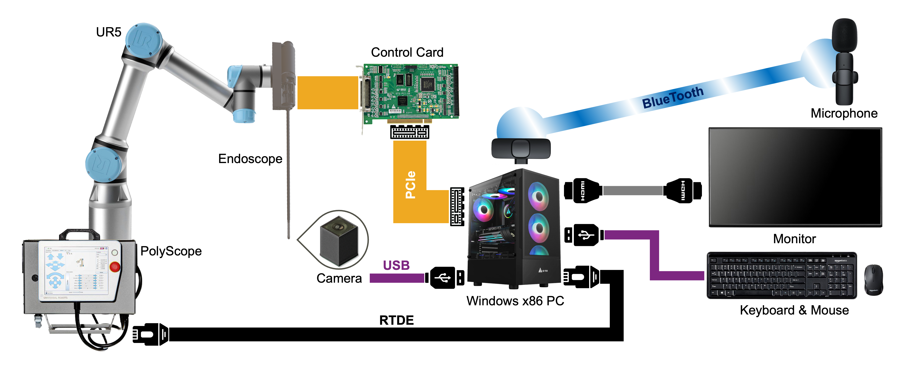

# Development reference

Use the [README](../README.md) for setup, launching, controls, shortcuts, and tasks. This file covers configuration and implementation details for maintaining CRF.

## Code map

| Path | Responsibility |
| --- | --- |
| `src/app.py` | Application entry point, HTTP API, resource ownership, and shutdown. |
| `src/static/` | Dashboard, keyboard controls, voice panel, and browser recording viewer. |
| `src/flex_endo_robo/control_node.py` | Motion coordinator, manual controls, RCM, and modeled Flex. |
| `src/flex_endo_robo/ur5_rtde_server.py` | UR5 RTDE connection, relay, and Freedrive. |
| `src/flex_endo_robo/kinematics.py`, `ur5_endo_flex.urdf` | Kinematics and robot geometry; both are under `src/flex_endo_robo/`. |
| `src/flex_endo_robo/flex_endo/` | Flex Python interface, native GTS driver, IPC, and PowerShell launcher. |
| `src/scope/camera.py`, `src/scope/yolo.py` | Camera capture, inference, detector categories, and observations. |
| `src/tasks.py` | Task IDs, shared state, execution, stop confirmation, and HTTP/voice task coordination. |
| `src/llm/` | Voice service, task mapping, fast Stop detection, dependency pins, and settings. |
| `src/llm/streamingcommand_sdk/` | Vendored speech SDK, CLI, examples, licenses, and model provenance. |
| `src/status.py` | State snapshots and session recording. |
| `src/recording_web.py`, `src/recording_viewer.py` | Standalone browser replay and desktop viewer/export CLI. |
| `src/diagnostics.py` | Dashboard diagnostic feed and per-run warning/error files. |
| `src/keyboard_listener.py` | Windows bridge for browser-reserved Alt shortcuts. |
| `tests/` | Hardware-free Python checks, Node dashboard checks, and native C++ tests. |
| `environment.yaml` | Pinned Windows Conda environment, including voice requirements. |

## Advanced configuration

Run `python src/app.py --help` for all options. Direct Python launches using Flex require a separately running native driver. The PowerShell launcher manages the driver but forwards only its own supported settings; it does not forward arbitrary Python flags.

| Python option | Default | Purpose |
| --- | --- | --- |
| `--camera-index` | `0` | DirectShow camera device index. |
| `--model` | `src/scope/yolov8n.pt` | YOLO weights. |
| `--host-web` / `--port-web` | `127.0.0.1` / `8080` | Dashboard bind address and port. |
| `--robot-ip` / `--relay-port` | `192.168.1.10` / `9000` | UR5 address and local RTDE relay port. |
| `--urdf` | `src/flex_endo_robo/ur5_endo_flex.urdf` | Robot/endoscope geometry. |
| `--rcm-local` | `0 0 -0.30` | Local RCM coordinates, in meters. |
| `--tip-local` | `0 0 0.20195` | Local tip coordinates, in meters. |
| `--camera-roll-offset-deg` | `0` | Optical roll offset in degrees, from −180 to 180. |
| `--jog-speed-scale` | `10` | Manual arm speed factor; choices: `3`, `5`, `10`, `15`. |
| `--recordings-dir` | Repository `recordings/` | Session recording output directory. |
| `--llm-config` | `src/llm/settings.json` | Speech/command model configuration. |
| `--microphone` | System default | Input device name on the server PC. |

The mutually exclusive `--camera-only`, `--flex-only`, and `--arm-only` modes select camera preview, Flex without UR5, and UR5 with modeled Flex, respectively. No mode flag selects the full system. Camera-only still starts the speech service, but connects to neither robot device.

For example, select a microphone and configuration while previewing a camera:

```powershell
python src/app.py --camera-only --microphone "Microphone name" --llm-config src/llm/settings.json
```

For a custom detector, update `CATEGORIES` and `COLORS` in `src/scope/yolo.py` to match its class IDs. Camera resolution and frame-rate defaults are in `src/scope/camera.py`. Launch settings and runtime configuration changes are retained in recordings.

## Control and task implementation



The supported deployment uses Windows for GTS and DirectShow, with the UR5 connected directly through RTDE. The control coordinator requests 125 Hz updates and publishes dashboard snapshots at 20 Hz. Flex IPC, RTDE motion/telemetry, camera capture, inference, and HTTP handling run independently. Inference uses the latest frame to avoid accumulating a backlog.

The [alternative architecture image](../imgs/system_architecture_alt.jpg) shows a Jetson deployment concept; the current Windows setup does not require that machine or a ROS bridge.

Task definitions and ownership live in `src/tasks.py`. Task entry stops the previous motion and waits for device acknowledgements before activation. Revisions prevent delayed requests from affecting newer selections. Continuous Tasks 1–10 and 16 remain active at limits; Tasks 11–15 return to Task 0 after confirmed completion. Manual robot controls remain locked during tasks, stopping, errors, and Freedrive transitions.

With a connected UR5, look tasks require active RCM. Task 12 restores the captured RCM reference axis while retaining pivot and insertion depth, then waits for the arm and Flex zero to settle. Tracking additionally requires calibrated Flex, a capable driver, and fresh observations for the selected camera/category revision. Refer to the source for device-specific checks rather than duplicating them in clients.

The browser handles held motion, zoom, and Freedrive so releases are immediate. `src/keyboard_listener.py` forwards Alt+B/P/T/R/M/L on Windows while the dashboard owns a fresh focus lease, suppressing browser defaults and the Alt-release menu action. Outside the dashboard, normal shortcuts continue to work. Modeled Flex arc controls use pointer input; R/F roll shortcuts use the hardware interface.

### CB3 Freedrive compatibility

The current PolyScope 3.15 / CB3 integration intentionally uses `ur_rtde`'s `teachMode()` / `endTeachMode()` compatibility API. The legacy control-script handlers support `freedrive_mode()` / `end_freedrive_mode()`; newer `freedriveMode()` / `endFreedriveMode()` handlers are gated to PolyScope 5.10 and later. See the [UR release notes](https://www.universal-robots.com/articles/ur/release-notes/release-note-software-version-31xx/) and [upstream control script](https://gitlab.com/sdurobotics/ur_rtde/-/blob/master/scripts/rtde_control.script).

Freedrive entry clears queued targets and the RCM pivot. The dashboard heartbeat lease expires after 1.5 seconds; a controller RTDE watchdog also stops the program if relay communication fails. Preserve these behaviors when changing control or shutdown paths.

## Voice integration

The [voice reference](../src/llm/README.md) covers dependency pins, model revisions, cache handling, worker processes, diagnostics, and encoding. The SDK is vendored from the supplied CRF-LLM archive; retain its licenses, notices, and provenance.

To test speech independently of the robot app using the app's configuration:

```powershell
python -m streamingcommand.cli --config src/llm/settings.json run
python -m streamingcommand.cli --config src/llm/settings.json run src/llm/streamingcommand_sdk/example/cantonese.wav
```

The parser produces intent (`I`), target (`T`), and direction (`P`) slots. `src/llm/mapping.py` maps them to task IDs:

| Intent (`I`) | Direction (`P`) | Task ID |
| --- | --- | --- |
| `stop` | Any | 0 |
| `move` | `forward` / `backward` | 1 / 2 |
| `zoom in` / `zoom out` | `none` | 3 / 4 |
| `bend` | `up` / `down` / `left` / `right` | 5 / 6 / 7 / 8 |
| `self rotate` | `left` / `right` | 9 / 10 |
| `bird view` | `none` | 11 |
| `reset` | `none` | 12 |
| `clean lens` | `none` | 13 |
| `spray water` / `spray air` | `none` | 14 / 15 |
| `track` | `none` | 16 |

Except for Stop, non-tracking commands require target `none`. Tracking accepts the current detector's categories; target `none` retains the selected category. Named tracking selects its category, confirms stopping, and waits up to two seconds for fresh inference for that revision. A fresh frame with no target enters Waiting for target. Stop, INTERRUPT, disabling LISTEN, or changing category cancels pending preparation.

Fast Stop detects the standalone English word in ASR partials/finals only while LISTEN is enabled. Other partial, unresolved, duplicate, stale-generation, or superseded command results cannot start tasks. Stop invalidates older pending voice results. Keep all accepted voice tasks on the same coordinator path as dashboard tasks.

## Recording and diagnostics

Sessions use five-minute JSONL/MJPEG segments under `recordings/`. The recorder retains state, commands, detections, task transitions, configuration, and speech/dispatch events. It does not save raw microphone audio. Browser replay reads bounded timeline windows and indexed JPEG byte ranges.

The browser viewer has its own assets in `src/static/recording.*`; `src/recording_web.py` serves it without opening camera or robot connections. Both viewers read the recording format maintained by `src/status.py`.

Additional desktop viewer options:

```powershell
python src/recording_viewer.py recordings/SESSION_ID --start 120 --duration 60
python src/recording_viewer.py recordings --live
python src/recording_viewer.py --help
```

`--duration` defaults to 300 seconds and accepts a maximum of 3600. Input can be a recordings root, session, segment, or `events.jsonl`; `--output` exports PNG/PDF, and `--summary` prints JSON without GUI dependencies.

`src/diagnostics.py` forwards server messages to the dashboard independently of RECORD. Each app run creates a UTF-8 `logs/crf_YYYYMMDD_HHMMSS_microseconds_PID.log` using Hong Kong time, including warning/error tracebacks and run start/end markers. Browser-originated messages are forwarded to the terminal without looping back into the diagnostic feed.

## Dependencies and generated files

The environment installs `kdl-parser-jvytee`. `dependencies/kdl_parser` is an optional upstream source-reference submodule, with its own [README](../dependencies/kdl_parser/README.md) and [license](../dependencies/kdl_parser/LICENSE). Populate it at the commit recorded by CRF with:

```powershell
git submodule update --init --recursive dependencies/kdl_parser
```

The speech SDK is ordinary vendored source, not a submodule. Preserve its source, configuration, licenses, model manifest, and provenance, along with the bundled YOLO weights and GTS SDK `gts.dll` / `gts.lib`.

`.gitignore` excludes native build outputs, Python environments/caches, downloaded `models/` directories, logs, and recordings. StreamingCommand normally stores models and worker logs in user directories; `STREAMINGCOMMAND_CACHE` and `STREAMINGCOMMAND_LOGS` override those locations.

## Validation

Run checks from the repository root with `crf` activated. Python tests use fake hardware; Node.js is required for dashboard checks:

```powershell
python -m unittest discover -s tests -p 'test_*.py'
Get-ChildItem tests/test_*.js | ForEach-Object {
    node $_.FullName
    if ($LASTEXITCODE -ne 0) { throw "Dashboard test failed: $($_.Name)" }
}
```

Native C++ tests in `tests/` exercise motion and spray behavior with mocked GTS calls. For changes to the driver, build the x86 Visual Studio solution and run the relevant native checks using an available C++ toolchain.

For documentation-only edits, verify local links and heading anchors, script paths, flags/defaults against their parsers, task IDs against `TASK_NAMES`, and shortcut descriptions against the browser/native handlers. Run `git diff --ignore-submodules=all --check` for whitespace validation. If submodule status cannot run because its metadata is inaccessible, validate `.gitmodules` against the indexed gitlink without changing repository permissions.
